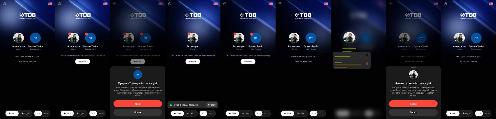

# TDB Online — multi-user login prototype

Flutter prototype of the TDB Online login for people with more than one saved
user (e.g. a personal login plus company logins). Built from the Figma file
**gs** (`bhNbPj2XiOtcmGTSG058Cd`, page «multi-user»).



## What's in it

- **Profile grid** — saved users as 78 pt avatars; 2- or 3-user versions.
- **Animated background** — a soft light drifting behind tilted glass, as a
  fragment shader (`shaders/glass_bg.frag`, light variant `glass_bg_light.frag`).
- **Dark / Light** — prototype switch at the bottom; everything crossfades.
- **Remove a saved login** — press & hold a profile → red «−» badges → tap a
  profile → confirm sheet «Хасах» → it leaves with a «Буцаах» (undo) toast.
- **«Өөр хэрэглэгчээр нэвтрэх»** — opens the username / password login, with a
  back button and its own Dark / Light switch.
- Top bar: help «?» and a language flag (shows the language you can switch to).

Not wired to a backend: «Нэвтрэх» and the profile taps only log to the console.

## Run

```bash
flutter pub get
flutter run                 # iOS simulator or device
```

Web (for quick sharing / screenshots):

```bash
flutter build web --no-web-resources-cdn
python3 -m http.server 4480 --directory build/web
```

The real refraction on `LiquidGlassButton` needs Impeller (iOS); the web falls
back to a blur. The button is currently unused (see tag `v3-liquid-glass`).

## Code map

| File | What |
| --- | --- |
| `lib/profile_grid_screen.dart` | Main screen, palette (`_Look`), top bar, controls |
| `lib/remove_login_flow.dart` | Saved profiles, manage mode badge, confirm sheet, undo toast |
| `lib/password_login.dart` | Username / password login screen |
| `lib/glass_background.dart` | Animated shader background + shared clock |
| `lib/liquid_glass_button.dart` | iOS 27-style Liquid Glass button (unused) |
| `saved/` | Clips and screenshots of each version |

## Versions

Each step is a git tag: `v1-glass` → `v2-light-switch` → `v3-liquid-glass` →
`v4-users-flags` → `v5-smaller` → `v6-flags` → `v7-other-user-link` →
`v8-delete-login` → `v9-hold-to-manage` → `v10-password-login` →
`v11-login-back-theme`.

## Credits

- Font: [Manrope](https://fonts.google.com/specimen/Manrope) (SIL OFL, `fonts/OFL.txt`).
- Language flags: supplied by the TDB design team (`assets/flags/SOURCE.txt`).
